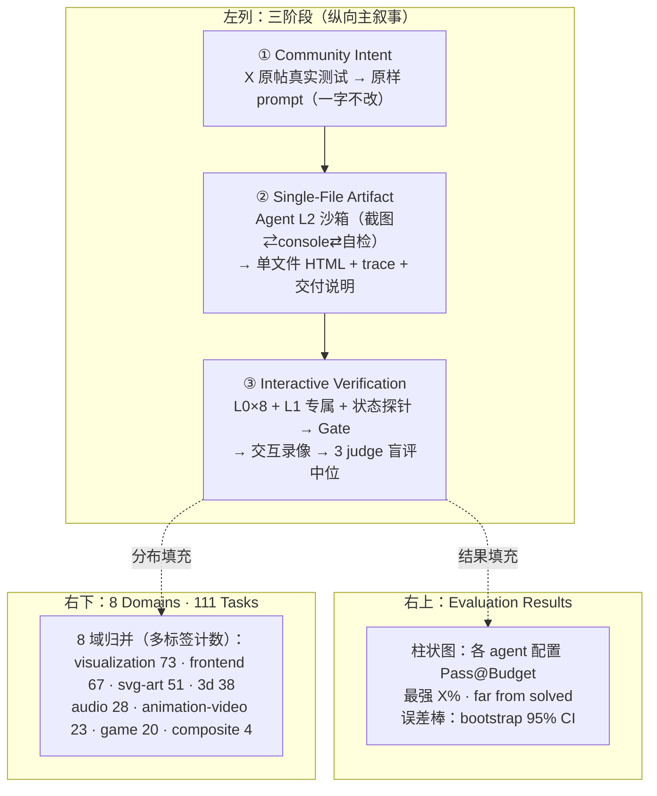

# Figure 2 · Overview（对标 GameCraft Fig 2）

## 定位

论文第 2 页整幅图。一张图回答四件事：**怎么评（左列三阶段）、结果如何（右上柱状）、题分布（右下环形）、我们是谁（底部三徽章）**。GameCraft 用此布局讲完整个故事，我们同构但换上我们的数据。

## mermaid 布局稿

## 布局规格（元素级）

| 区块 | 位置 | 内容 | 绘制细节 |
|---|---|---|---|
| 左列 | 全高 55% | 三阶段纵向卡 | 每阶段编号圆徽章 ①②③；阶段间向下箭头；每卡 2–3 行小字 |
| 右上 | 右列上 45% | 结果柱状图 | 横轴 12 配置、纵轴 Pass@Budget 0–100%；最强柱高亮 + 数值标签；CI 误差棒 |
| 右下 | 右列下 55% | 域环形图 | 8 段，标签带计数；脚注注明「8 域归并报告口径，多标签，总和 > 111；Table 6 另报 12 个 `code2Tags` 原始计数」 |
| 底部 | 全宽 | 三徽章 | `Real Community Prompts` · `Single-File` · `Runtime State Probe` |

## 数据来源

- 柱状：跑批结果 results/（2027-03 后填充；设计期用灰色占位柱 + "pending"）
- 环形：`leaderboard/data/tasks.json` 的 `domain_counts`，由 `scripts/build_manifest.py` 从 `cases.jsonl` 生成（8 域归并为报告口径）；**不得**用 12 个 `code2Tags` 原始计数冒充 8 域（design-decisions #20）
- 三阶段文案：manuscript §1.2 / §3.3 desiderata（D1–D3）与 §5.7 逐条回扣

## 与 GameCraft Fig 2 的差异（图上要可见）

- 其阶段①是"Agent Workspace（终端）"，我们①是"Community Intent（X 原帖）"——**题源真实性是图上第一眼可见的差异**
- 其环形图 15 家族 vs 我们 8 域
- 其柱状无 CI 误差棒，**我们带**（期刊严谨性信号）

## 正式绘图指引

- 工具：Figma / draw.io，最终导出 PDF 矢量
- 尺寸：双栏全宽（~180mm × 110mm）
- 三阶段列用统一主色；结果柱状用第二色；环形图用 8 色域色板（后续所有按域分析图沿用同一色板——图色即域 ID）
- 底部徽章样式与 Fig 1 保持一致

## 状态

- [x] mermaid 布局稿
- [ ] 结果数据（2027-03）
- [ ] 正式矢量绘制
