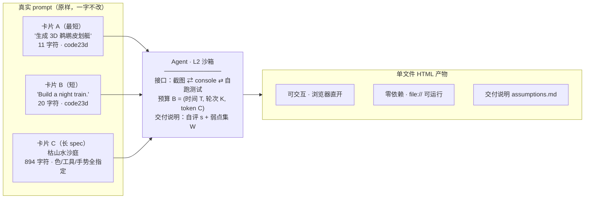

# Figure 3 · Problem Definition（对标 GameCraft Fig 3）

## 定位

§3 Problem Formulation 的配图。把形式化定义图形化：**左边是真实 prompt（原样卡片），中间是 Agent 与其沙箱接口，右边是产物堆叠**。GameCraft 用三个游戏规格卡 + Godot 环境 + 游戏产物堆叠；我们用真实社区 prompt 的三个极端样本，直观展示"题面从 11 个字符到 894 个字符都存在"。

## mermaid 布局稿

## 布局规格（元素级）

| 区块 | 内容 | 绘制细节 |
|---|---|---|
| 左列：3 张 prompt 卡 | 真实原帖文本原样呈现，卡片带"字符数 + 域标签"角标 | 最短卡用等宽字体突出"11 字符也能是一道题"；长卡截断显示 + "…" + 全文尺寸标注 |
| 中央：Agent 块 | 沙箱接口图标（相机/console/终端）+ 预算公式 B=(T,K,C) + 交付说明字段（s, W）| 接口用双向箭头表示反馈循环（对齐 GameCraft 的 Action ⇄ Feedback）|
| 右列：产物堆叠 | 3 层堆叠卡片：HTML + trace + assumptions.md | 每层标注 file:// 直开 / 零依赖 |
| 底部公式带 | Definition 1–5 索引 + 记号 p, A*, B, τ | 数学斜体 |

## 数据来源

- 卡片 A：cases.jsonl b24-astra-2096831592769765388（真实 11 字符 prompt）
- 卡片 B：new-e1f998f88e50（"Build a night train."，真实 20 字符）
- 卡片 C：case-085 枯山水（894 字符，色值/五工具/手势全指定）
- 三张卡覆盖"短到荒谬 → 中等 → 长规格"谱系，直接支撑 Underspecified 到 Full-spec 的双峰论证

## 正式绘图指引

- prompt 卡必须逐字展示原文（含语言），不得改写——图本身就是 D1 的展示
- Agent 块中央放接口循环图（截图 → 观察 → 修复 → 重截图）
- 预算与交付说明用等宽字体标注字段名（T, K, C / s, W），与正文记号一致
- 尺寸：双栏全宽，~180mm × 90mm

## 状态

- [x] mermaid 布局稿
- [ ] 正式矢量绘制
