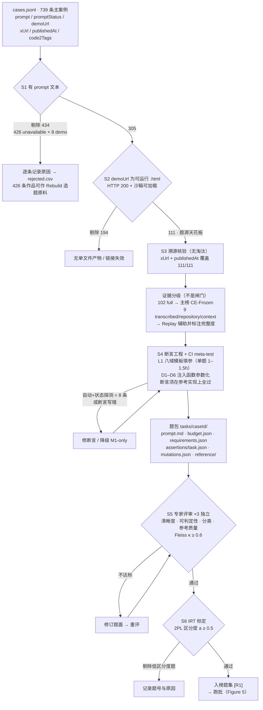

# Figure 4 · 构造流水线（本文独有；GameCraft 无对应图）

## 定位

`manuscript.md` **§4.2 Benchmark Construction** 的配图，对应正文 **Table 4**。完整呈现"从 739 条数据源到一道全测量题"的全流程：**每道闸门的淘汰数字上墙、每条返工回路画虚线、证据分级单独成节点**。这张图是数据集质量论证的核心——淘汰透明度 = 数据可信度。GameCraft-Bench 的 §3.4 用"标注员 + oracle 交叉验证"论证任务质量；我们用"逐条淘汰记录 + CI meta-test + 专家评审"完成同一功能，且这个论证必须以可复现的数字呈现。

## mermaid 完整版

## 布局规格（元素级）

| 元素 | 规则 |
|---|---|
| 主干节点 | 圆角矩形，流水线蓝；每节点 = 阶段名 + 判据一行 + 剩余数 |
| 淘汰支线 | 红色，向右引出；**淘汰数字必须上墙（434 / 194 / [R1]）**；每条支线末端写"逐条记录原因" |
| S3 与证据分级节点 G | **均不用菱形**（不是闸门），用虚线边框矩形，与 S1/S2 闸门视觉区分——这是本文口径的关键：S3 只核验、不淘汰；`promptStatus` 是证据等级，不是准入条件 |
| 返工回路 | 红色虚线 + 返回箭头（S4 修断言、S5 重评）——失败路径与成功路径同等显眼（GameCraft 惯例：BUILD=0 也要画出来）|
| CI meta-test | 双线边框强调：全流程唯一自动化质检，位于 S4 内部而非独立阶段 |
| 漏斗数字 | `739 → 305 → 111` 全部加粗；`111/111 publishedAt` 单独标注（污染控制的物理前提）；**120 不得作为中间阶段出现在图上**，它只是全库 `.html` demo 的独立统计 |
| Rebuild 出口 | X1 向下虚线连"Rebuild 造题流水线（未来扩容题池）"——表明 426 条不是废料 |

## 数据来源（全部实测，v556ab07）

| 数字 | 口径 |
|---|---|
| 739 | 主案例库 `cases.jsonl` 总记录 |
| 305 / 434 | `prompt` 字段非空 / 为空（434 = 426 `unavailable` + 8 `demo`）|
| **111 / 194** | 305 条中 `demoUrl` 以 `.html` 结尾且可加载 / 其余。全库共 **120** 条 `.html` demo，其中 **9 条无 prompt 文本**（8 `demo` + 1 `unavailable`）已在 S1 剔除，故 120 − 9 = 111 |
| **111 / 0** | S3 核验 `xUrl` + `publishedAt`：覆盖 **111/111**，不淘汰任何题；污染切分因此适用于整个普查集 |
| 102 / 9 | 111 条中 `promptStatus = full` / `transcribed(3) + repository(4) + context(2)` |
| 100 / 111 | `demoUrl` 指向 `miaai-lab.github.io` 单一合集（§9.3 来源偏斜，须分层报告）|
| `[R1]` | S4–S6 的实际淘汰数量，由跑批后的 `analysis/` 生成，不得手填 |

> **口径警告（写图时不得改回）**：有两个已经踩过的坑。
> ① 111 **不是**"201 条完整级 prompt ∩ 可运行 demo"的结果——完整级 201 条里含 `.html` 参考的仅约 102 条，那是另一条统计路径。
> ② `739 → 305 → 120 → 111（剔 9）` **也是错的**：120 是**全库** `.html` demo 数，不是 S1 之后的中间态；111 全部带 `xUrl` + `publishedAt`，不存在"再剔 9"。把全库统计与条件统计混用，会得到被仓库自身 `validate.py` 打脸的漏斗。
> 正确口径只有一条：**739 →（S1 剔 434）→ 305 →（S2 剔 194）→ 111 →（S3 核验 0 淘汰）**。

## 正式绘图指引

- 尺寸：单栏高图（~120mm × 180mm）或双栏全宽横排；节点多，优先双栏。
- 主干 9 节点，右侧淘汰/返工支线 5 条；避免交叉线；淘汰支线统一走右侧，返工回路走左侧。
- 论文图注（与 manuscript §4.2 一字不差）：*From the 739-record source to an admitted fully-measurable task. S1–S2 are mechanical gates with measured rejection counts (434 / 194); S3 verifies source traceability (111/111 carry `publishedAt`) and assigns evidence grades without excluding tasks; S4 engineers assertions from eight domain templates and validates them against the reference implementation in CI; S5 is a three-reviewer expert gate (Fleiss' κ ≥ 0.6); S6 removes tasks after item-response calibration. Rejected record IDs and reasons are released with the dataset.*
- 图内所有数字由 `scripts/build_manifest.py` 从 `cases.jsonl` 生成，与 Table 4 同源；任何一处改动须同时更新 Table 4、§4.1、§4.2 与本文件。

## 状态

- [x] mermaid 完整版（可直接渲染）
- [x] 口径与正文 Table 4 / §4.1 / §4.2 对齐（v0.6 二次校准）
- [ ] 正式矢量绘制
- [ ] `[R1]` 实际淘汰数（跑批后）
