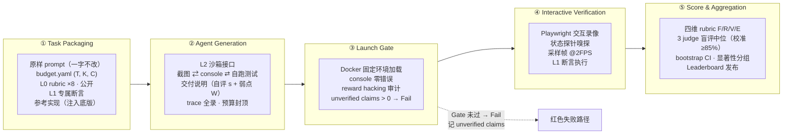

# Figure 5 · 评测管线五步（对标 GameCraft Fig 5——全文最重要的方法图）

## 定位

§5 Evaluation Methodology 的配图，五列编号管线。GameCraft 的 Fig 5 用五列彩色编号、隐藏 rubric 底色区分、失败红色路径（BUILD=0 → Final Score 0）、采样帧网格（@2FPS），审稿人不读正文即可复述其协议——我们的 Fig 5 必须达到同等信息密度，并在两个位置形成可见差异：**rubric 公开（vs 其隐藏）与验收作为被测构念（vs 其仅作评审手段）**。

## mermaid 布局稿

## 布局规格（元素级，五列各 ~120px 宽）

| 列 | 编号徽章 | 必上墙要素 | 颜色语义 |
|---|---|---|---|
| ① Task Packaging | 圆徽章 1 | 原样 prompt / budget 三元组 / **L0 ×8 公开**（绿字）/ L1 / 参考实现 | 蓝 |
| ② Agent Generation | 2 | L2 接口三通道 / 交付说明字段（s, W）/ trace 全录 | 蓝 |
| ③ Launch Gate | 3 | Docker / console 零错误 / reward hacking 审计 / **未过 → Fail（红字）** | 蓝 + 红失败出口 |
| ④ Interactive Verification | 4 | 交互录像 / 状态探针 / **采样帧 @2FPS 网格** / L1 执行 | 蓝 |
| ⑤ Score & Aggregation | 5 | F/R/V/E / 3 judge 中位 / bootstrap CI / Leaderboard | 蓝 |

列间箭头 →；③ 到红色失败出口用粗红箭头（对齐其 BUILD=0 样式）。

**底部三徽章**：`Real Community Prompts` · `Single-File` · `Runtime State Probe · 111 Tasks`

## 与 GameCraft Fig 5 的两个图上差异（必须在图中可见）

1. **公开 vs 隐藏**：其 hidden rubric 用深色底标注；我们第①列的 L0 rubric 用绿字标 "public"。审稿人扫一眼即见透明度立场。
2. **验收的双重身份**：其 verification 只是评审手段；我们第④列产出的证据同时喂给 M2（被测构念）——用第④列到"M2 construct"的小分支箭头表达。

## 数据 / 数字来源

- 111 / 8 条全局断言 / @2FPS / 3 judge / 85% judge 启用门槛 / **0.80 确定性权重 + 0.20 judge（满足 ≥75% 可验证性预算）**：全部来自 manuscript §4–§5，数字必须与正文一字不差。注意正文 §5.4 的评分配方为 `𝟙[Gate] · min(0.35F + 0.30R + 0.20V + 0.15E, Cap)`，F/R/E 由确定性断言产生（合计 0.80），V 由 judge 产生（0.20）——图上标 75% 时应写作"预算下限"，标 80% 时写作"实际权重"。
- 采样帧网格：正式版从枯山水参考实现的交互录像中截 8 帧（真实画面）

## 正式绘图指引

- 尺寸：双栏全宽 ~180mm × 80mm；五列等宽
- 编号徽章圆形、列内条目用小圆点、失败出口粗红箭头
- 采样帧网格用真实枯山水录像帧（8 帧横排在第④列下方）
- 底部徽章样式与 Fig 1/2 一致

## 状态

- [x] mermaid 布局稿
- [x] SVG 视觉稿（见对话历史 fig5 渲染）
- [ ] 正式矢量绘制（补采样帧网格 + 红色失败路径插画）
